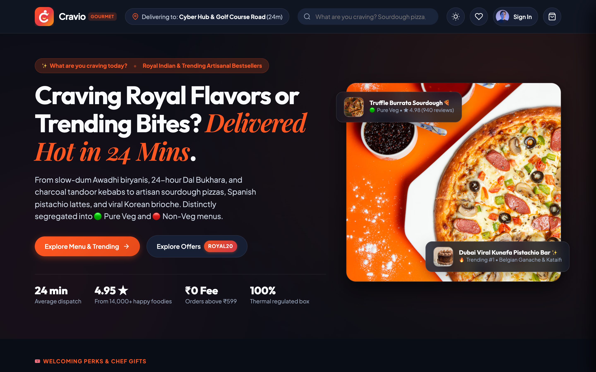
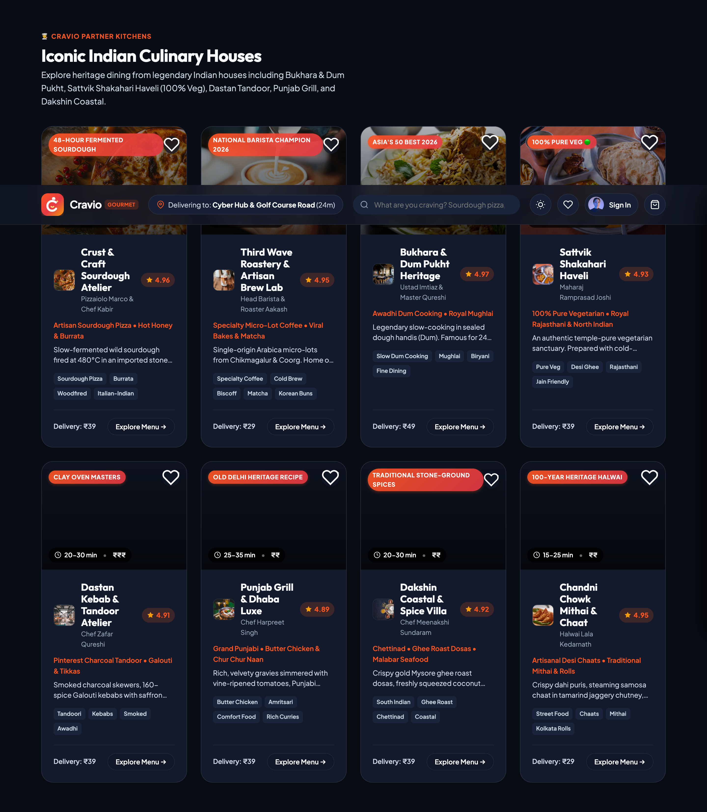
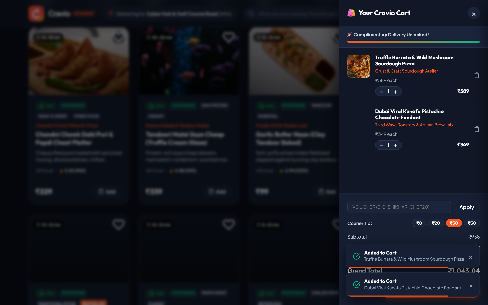
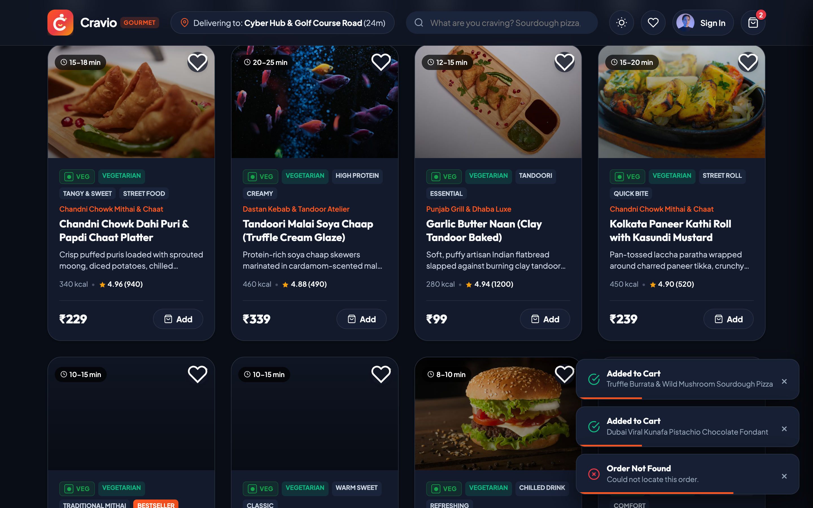
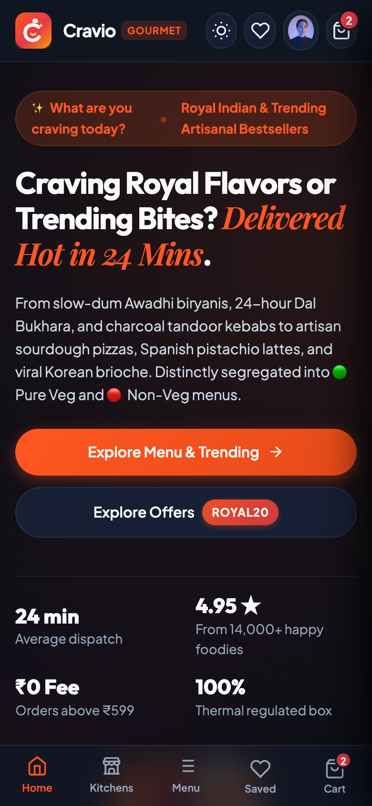
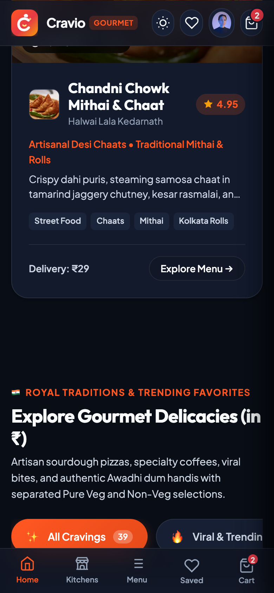
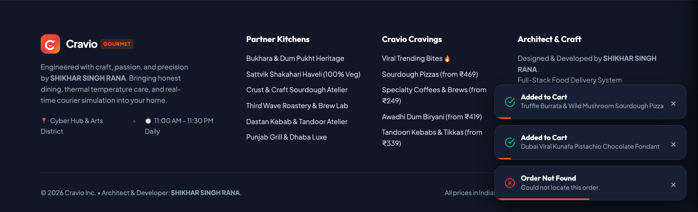

# 🍽️ Cravio | What Are You Craving Today?

> **Lead Architect & Developer**: **SHIKHAR SINGH RANA**  
> **Repository**: [https://github.com/shikharsinghrana0-hash/cravio-food-delivery](https://github.com/shikharsinghrana0-hash/cravio-food-delivery)  
> **Live Local Port**: [http://localhost:8080](http://localhost:8080)

**Cravio** is a modern, high-energy, and responsive Food Delivery System website inspired by **ChefDesk**, **Magnific Bistro**, **Phygital Kitchen Labs**, and **Pinterest fine-dining editorial aesthetics**.

Built with pure, modern HTML5, CSS3 tokens, and modular vanilla ES6+ JavaScript. Works instantly in any browser with **zero external framework dependencies, zero build steps, and full offline/local compatibility**. All menu items, delivery charges, tips, and discounts are calculated dynamically in **Indian Rupees (₹)**.

---

## 📸 Screenshots Gallery

All visual assets and high-resolution interface captures of the **currently running live website** are available in the [`screenshot/`](./screenshot/) folder.

### 1. Desktop Experience & Hero Banner
*Captures brand mascot logo, live delivery hub zone, headline, quick search bar, and key trust metrics.*


### 2. Partner Kitchens Showcase (ChefDesk, Magnific, Phygital)
*Curated culinary partners with ratings, tags, delivery estimates, and price indicators.*


### 3. Food Menu, Category Carousel & Real-Time Filter Toolbar
*Multi-facet filtering: instant keyword search, category pills, price slider (₹150 - ₹1200), and dietary tags.*


### 4. Interactive Slide-Out Cart Drawer
*Dynamic item stepper (`- [qty] +`), promo voucher applicator, chef note input, and live ₹ order calculation.*


### 5. Live GPS Order Tracking with Canvas 2D Route Simulation
*Real-time 4-stage stepper, animated courier driver route across city road network, and driver contact cards.*


### 6. Mobile iPhone Experience with Fixed Bottom Navigation Bar
*Fully responsive on mobile phones (≤640px) featuring a thumb-friendly glassmorphic 5-tab bottom navigation.*
<p align="center">
  
  &nbsp;&nbsp;
  
</p>

### 7. Clean Developer & Architect Attribution
*Presented at the very end of the page ("at last") with clean typography and no clutter.*


---

## 💡 Why the Name "CRAVIO"?

- **Rolls Off Everyone's Tongue**: When people get hungry, their immediate subconscious thought is *"What am I craving today?"*. **Cravio** captures that universal appetite in two punchy, memorable syllables (`Cra-vi-o`).
- **Catchy & Creative**: Friendly, energetic, and modern—similar to leading global platforms like Swiggy, Zomato, or Deliveroo.
- **Humanized & Warm**: Directly invites diners to satisfy their cravings with fine food cooked to order.

---

## 👨‍💻 Developer Information

- **Lead Developer & Architect**: **SHIKHAR SINGH RANA**
- **Role**: Full-Stack Web Developer & UI/UX Architect
- **Special Creator Promo Code**: Use voucher **`SHIKHAR`** at checkout for flat **₹100 Off**!

---

## 🌟 Core Features & Technical Capabilities

1. **Brand Mascot Logo**: Smiling **"C"** vector mark with a tilted chef's toque hat and a flavor sparkle star.
2. **Indian Rupee (₹) Pricing**: Real-world gourmet pricing across 8 categories (pizzas, burgers, ramen, bowls, desserts, viral bites).
3. **Dynamic In-Card Steppers**: Food cards seamlessly morph their "Add" button into interactive `[-] [qty] [+]` steppers when added to cart.
4. **Live Order Tracking Modal**: 4-stage order stepper with an **animated HTML5 Canvas GPS map** simulating a courier vehicle traveling in real-time.
5. **Sound Effects (Web Audio API)**: Synthesized audio chimes for adding items, applying coupons, and placing orders.
6. **Confetti Celebration Engine**: Canvas-based particle explosion upon successful checkout.
7. **LocalStorage Persistence**: Cart, Wishlist, vouchers, customer profile, and dark/light mode stay synced across page reloads.
8. **100% Responsive Layout**: Dedicated desktop and mobile phone designs with zero layout breakage.

---

## 📁 Repository Structure

```
cravio-food-delivery/
├── index.html              # Semantic HTML master document, dialog modals, drawers
├── package.json            # Project scripts and metadata
├── README.md               # Documentation and visual screenshot walkthrough
├── server.py               # Zero-cache local Python HTTP server
├── css/
│   ├── style.css           # Design tokens, color palettes, typography, buttons
│   ├── components.css      # Hero, Kitchen cards, Food cards, Drawers, Modals, Toasts
│   └── responsive.css      # Mobile breakpoints and mobile bottom navigation bar
├── js/
│   ├── data.js             # Master dataset in ₹ (kitchens, dishes, promo vouchers)
│   ├── state.js            # Reactive pub/sub state manager & LocalStorage engine
│   ├── utils.js            # Indian Rupee formatter, Web Audio chimes, Toast alerts
│   ├── components.js       # Dynamic UI card & stepper renderers
│   ├── tracker.js          # Live GPS order tracker & Canvas route animator
│   └── app.js              # Application controller, search, filters & checkout
├── screenshot/             # High-resolution UI captures of the running live site (10 views)
└── server.py               # Zero-cache local Python HTTP server
```

---

## 🎟️ Active Promo Codes (in ₹)

| Voucher Code | Discount Benefit | Min Order |
| :--- | :--- | :--- |
| **`SHIKHAR`** | **Flat ₹100 Off** (Developer's Special) | ₹399 |
| **`CHEF20`** | **20% Off** on fine dining | ₹699 |
| **`FREEDEL`** | **Free Delivery** (Thermal Courier) | ₹499 |
| **`MAGNIFIC`** | **Flat ₹150 Off** on luxury dining | ₹899 |

---

## 🚀 Running the Project Locally

```bash
# Clone the repository
git clone https://github.com/shikharsinghrana0-hash/cravio-food-delivery.git
cd cravio-food-delivery

# Run the local server
python3 server.py
# or
npm start
```
Open **[http://localhost:8080](http://localhost:8080)** in your browser.
